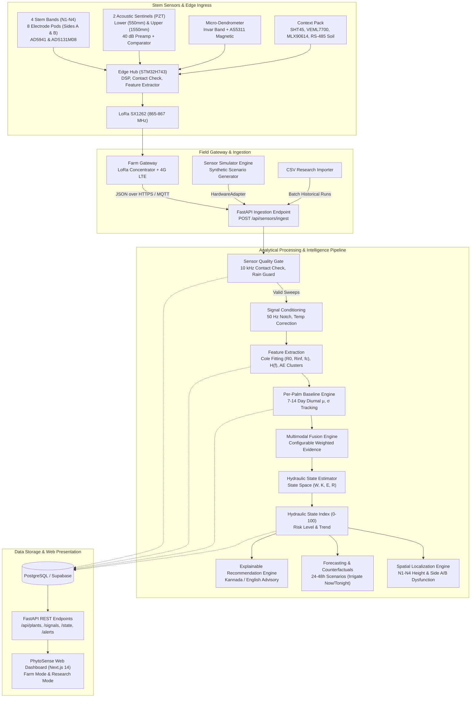

# 01. System Architecture: PhytoSense AI & PhytoHydra

**Document:** 01_system_architecture.md  
**Scope:** Monorepo Layout, End-to-End Pipeline, Edge vs. Cloud Partitioning, Hardware Abstraction, and Data Topologies  

---

## 1. High-Level System Architecture

PhytoSense AI is architected as an end-to-end, multi-tier platform connecting stem-attached physiological sensors to an intelligent cloud analytics core and a real-time web dashboard.



---

## 2. Monorepo Structure

The repository is organized as a clean, modular monorepo isolating presentation, business logic, data generation, and machine learning components:

```text
/
├── apps/
│   └── web/                             # Next.js 14 App Router, TypeScript, Tailwind CSS, shadcn/ui
│       ├── app/                         # App routes: overview, plants, monitoring, alerts, forecast, experiments
│       ├── components/                  # UI components: HSI Gauge, 3D Stem Visualizer, Recharts series
│       ├── hooks/                       # Custom React query & SSE/WebSocket hooks
│       └── lib/                         # Client API services, translation dictionaries (Kannada/English)
│
├── services/
│   ├── api/                             # FastAPI backend service
│   │   ├── adapters/                    # HardwareAdapter implementations (Simulator, LabRig, PhytoHydra)
│   │   ├── routers/                     # REST API routers: plants, sensors, state, alerts, research
│   │   ├── services/                    # Database ORM, caching, event broadcasting
│   │   └── main.py                      # FastAPI application entrypoint
│   │
│   ├── simulator/                       # Biophysical synthetic sensor generator
│   │   ├── cole_physics.py              # Cole-Cole relaxation impedance spectra math
│   │   ├── transfer_physics.py          # Multisine multi-height attenuation & phase shift
│   │   ├── acoustic_physics.py          # Cavitation hit generation (Poisson/Hawkes processes)
│   │   ├── dendrometer_physics.py       # Diurnal stem shrink/swell cycle
│   │   ├── context_physics.py           # Solar radiation, temperature, VPD, soil moisture
│   │   └── scenarios.py                 # Injectable scenarios (Drought, Root-Side, Sensor Fail, Rain)
│   │
│   └── ml/                              # Signal processing, baseline learning, and state estimation
│       ├── quality_gate.py              # 10 kHz contact check, rain/saturation validation
│       ├── signal_processing.py         # 50 Hz notch, PT1000 temperature correction, detrending
│       ├── cole_model.py                # Levenberg-Marquardt non-linear Cole model parameter fitting
│       ├── baseline_engine.py           # Per-palm rolling diurnal baseline (μ, σ per hour/sensor)
│       ├── fusion_engine.py             # Weighted multimodal evidence fusion
│       ├── state_estimator.py           # 4-state hydraulic state-space tracker (W, K, E, R)
│       ├── localization_engine.py       # N1-N4 vertical and Side A/B azimuthal localization
│       ├── forecasting_engine.py        # 6h-48h forward trajectories & counterfactual simulator
│       └── recommendation_engine.py     # Explainable rules & bilingual agronomic generator
│
├── packages/
│   ├── shared/                          # Universal mathematical formulas, unit conversions, constants
│   └── types/                           # Typed Pydantic models & TypeScript type definitions
│
├── data/
│   ├── simulated/                       # Pre-generated benchmark scenarios for offline demonstrations
│   └── schemas/                         # PostgreSQL DDL migrations, seed data, and JSON schemas
│
├── docs/                                # Technical documentation, CAD references, scientific protocols
├── scripts/                             # Local orchestration, Docker compose, test runners
├── .env.example                         # Environment variables configuration template
└── README.md                            # Setup and developer execution guide
```

---

## 3. Edge vs. Cloud Computing Division

A core requirement from the PhytoHydra dossier is autonomous edge resilience: arecanut plantations frequently suffer extended power and cellular outages during the southwest monsoon (June–September). The system is therefore split into an autonomous edge tier and an analytical cloud tier:

```text
┌─────────────────────────────────────────────────────────────┐
│                 EDGE NODE (STM32H743 MCU)                   │
├─────────────────────────────────────────────────────────────┤
│ 1. Hardware-level 10 kHz contact impedance verification     │
│ 2. Tetrapolar impedance sweep acquisition (100 Hz - 200 kHz) │
│ 3. 8-channel simultaneous ADC transfer capture (ADS131M08)  │
│ 4. Acoustic hit wake-up, timestamping & feature reduction   │
│ 5. PT1000 temperature reading & on-device temp correction    │
│ 6. Initial Quality Gating (GOOD / WARNING / BAD)            │
│ 7. Local Stage 1 rule-based stress alarm (independent of 4G)│
│ 8. LoRa transmission of compressed 10-minute feature packet │
└──────────────────────────────┬──────────────────────────────┘
                               │ LoRaWAN Uplink (~51 Bytes)
                               ▼
┌─────────────────────────────────────────────────────────────┐
│                 CLOUD PLATFORM (FastAPI / DB)               │
├─────────────────────────────────────────────────────────────┤
│ 1. Telemetry ingestion & database historical archiving      │
│ 2. Cloud Quality Gate (cross-sensor correlation, rain flag) │
│ 3. High-precision Cole-model parameter curve fitting        │
│ 4. Per-palm multi-week rolling diurnal baseline updates     │
│ 5. Multimodal weighted fusion & 0-100 HSI generation        │
│ 6. Extended Kalman Filter (EKF) state-space tracking        │
│ 7. 24-48h forward forecasting & irrigation counterfactuals  │
│ 8. Push / SMS alert dispatch in Kannada and English         │
│ 9. Web Dashboard & research data export (CSV / JSON)        │
└─────────────────────────────────────────────────────────────┘
```

---

## 4. Hardware Abstraction Layer (`HardwareAdapter`)

To prevent tight coupling between the software prototype and the physical hardware, the data ingestion interface is designed around the `HardwareAdapter` abstract base class:

```python
from abc import ABC, abstractmethod
from phytosense_types.schemas import SensorSweep

class HardwareAdapter(ABC):
    """
    Abstract interface decoupling the AI analytics and dashboard
    from the underlying physical hardware or synthetic data source.
    """
    @abstractmethod
    async def read_telemetry(self, plant_id: str) -> SensorSweep:
        """Fetch or synthesize a complete multi-band sensor sweep."""
        pass

    @abstractmethod
    async def trigger_calibration(self, plant_id: str) -> bool:
        """Trigger an on-device reference resistor/capacitor calibration."""
        pass
```

### Concrete Adapter Implementations
1. **`SimulatorAdapter` (V0.1 Prototype):** Generates mathematically grounded synthetic sweeps using the Cole model, acoustic burst Poisson models, and weather cycles.
2. **`CsvPlaybackAdapter` (V0.2 Research Trials):** Ingests and plays back timestamped CSV files collected from the 24-seedling controlled experiments.
3. **`LabRigAdapter` (V0.3 Evaluation Boards):** Reads live SPI/I2C data from the AD5941 and ADS131M08 evaluation boards connected to a Raspberry Pi 5.
4. **`PhytoHydraAdapter` (V0.4 Commercial Field Node):** Receives real LoRaWAN packets from the STM32H743 node forwarded via the farm gateway.

---

## 5. End-to-End Data Pipeline Stages

The end-to-end data processing workflow transforms raw electrical and physical measurements into actionable agronomic intelligence through 9 discrete stages:

1. **Ingestion:** Receives the 10-minute multi-modal telemetry payload.
2. **Quality Gate:** Verifies electrode contact impedance ($<8\,\text{k}\Omega$), rules out trunk surface wetting/rain, and checks sensor sanity. Flags sweep as `GOOD`, `WARNING`, or `BAD`.
3. **Signal Conditioning:** Applies a 50 Hz digital notch filter, subtracts DC drift, and normalizes sapwood resistivity to $25^\circ\text{C}$ reference using the PT1000 reading (+2%/°C correction).
4. **Feature Extraction:** Fits the non-linear Cole equation to extract $R_0, R_\infty, \alpha, f_c$; calculates transfer function gain $|H_{ij}|$ and group delay; computes acoustic hit frequency and 100–200 kHz energy fraction; calculates dendrometric daily shrinkage; computes canopy-air temperature differential and atmospheric VPD.
5. **Per-Palm Baseline Tracking:** Queries the plant's 7–14 day healthy baseline for the current hour of day. Computes standard deviation normalized $z$-scores:
   $$z_k(t) = \frac{x_k(t) - \mu_k(\text{hour}, \text{palm})}{\sigma_k(\text{hour}, \text{palm})}$$
6. **Multimodal Evidence Fusion:** Computes a transparent weighted composite score using configurable physiological weights: Electrical (30%), Transfer Function (20%), Acoustic Cavitation (20%), Dendrometry (10%), Thermal (10%), Context (10%).
7. **Hydraulic State Estimation:** Solves a 4-state linear state-space model tracking:
   - $W$: Stem tissue hydration
   - $K$: Stem xylem hydraulic conductance
   - $E$: Cavitation embolism load
   - $R$: Hydraulic recovery capacity
8. **Hydraulic State Index (HSI):** Projects the fused state onto a calibrated 0–100 scale:
   - **0–20:** Healthy (Full hydration, nominal conduction)
   - **21–40:** Mild Stress (Elevated midday tension, complete overnight refill)
   - **41–60:** Moderate Stress (Significant impedance shift, acoustic bursts initiated)
   - **61–80:** High Stress (Substantial cavitation, conduction drop, incomplete refill)
   - **81–100:** Critical Stress (Severe embolism, catastrophic hydraulic failure risk)
9. **Forecasting & Localization:** Projects future HSI under "Do Nothing" vs. "Irrigate Now" regimes, pinpoints trunk height ($N1–N4$) and side (A vs. B) conduction anomalies, and formats explainable advisories in Kannada and English.
