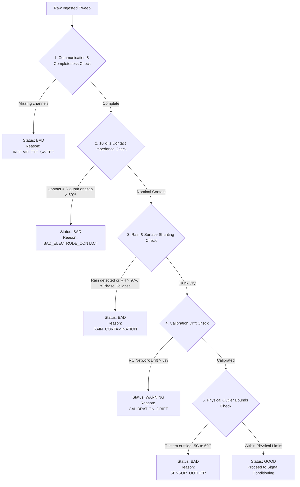

# 03. Signal Processing & Quality Gate Specification

**Document:** 03_signal_processing_and_quality_gate.md  
**Scope:** Sensor Quality Gating, Defensive Filtering, Temperature Normalization, and Cole Parameter Fitting  
**Status:** Mandatory Diagnostic Guard  

> [!CAUTION]
> **CARDINAL RULE OF AGRICULTURAL SENSING:**  
> Faulty hardware, loose titanium pins, battery brownouts, and monsoon trunk rain must **NEVER** be classified as plant hydraulic stress.  
> Any compromised sensor sweep must be intercepted by the Quality Gate, tagged with an explicit degradation reason, and prevented from influencing the Hydraulic State Index.

---

## 1. The Sensor Quality Gate Architecture

Every 10-minute sensor sweep passes through an automated validation gauntlet prior to entering feature extraction or baseline comparison:

### Quality Classification Definitions
1. **`GOOD`:** All 8 electrode contact impedances $<8\,\text{k}\Omega$; trunk dry; internal calibration reference verified within $\pm 2\%$; temperatures within biological range ($5^\circ\text{C}$ to $55^\circ\text{C}$). **Action:** Full analytical pipeline executes.
2. **`WARNING`:** Minor contact step increase ($30\%–50\%$) or calibration network drift between $2\%–5\%$. **Action:** Feature extraction proceeds with downgraded confidence score ($\times 0.7$); maintenance log entry created.
3. **`BAD`:** Detached pin ($>8\,\text{k}\Omega$); monsoon rain on trunk; saturated AE preamplifier ($>2.5\,\text{V}$ rail); corrupted packet. **Action:** Stress calculation is strictly paused; dashboard displays *"Data Quality Degraded — Stress Estimation Paused"*; hardware alert dispatched.

---

## 2. Quantitative Gating Rules

### 2.1 10 kHz Tetrapolar Contact Verification
The AD5941 performs an immediate 0.5-second contact impedance check across all 8 electrode pins at $10\,\text{kHz}$:
- **Normal Range:** $250\,\Omega$ to $3,500\,\Omega$ (titanium pin inserted 5–8 mm into outer fibrous palm trunk).
- **Upper Threshold:** $R_{\text{contact}} > 8,000\,\Omega \implies$ Pin loose or detached.
- **Step Change Gate:** If $\frac{|R_{\text{contact}}(t) - R_{\text{contact}}(t-1)|}{R_{\text{contact}}(t-1)} > 0.50 \implies$ Sudden mechanical disturbance.

### 2.2 Rain Contamination & Trunk Wetting Defense
During monsoon squalls in Shivamogga, rain runs down the vertical trunk stem, forming a water sheet over the bark. This shunts injected current through rainwater rather than internal sapwood:
- **Condition 1:** Ambient $\text{RH} > 97.0\%$ and context rain sensor active.
- **Condition 2:** Low-frequency impedance ($100\,\text{Hz}$) collapses by $>60\%$ in a single 10-minute interval with near-zero phase angle ($\theta > -2.0^\circ$).
- **Defense:** Trigger `RAIN_CONTAMINATION`. Lock HSI to the pre-rain value with a "Paused due to trunk rain" banner.

### 2.3 Acoustic Sentinel Saturation Guard
Acoustic emission preamplifiers operating at $40\,\text{dB}$ gain can saturate if mechanical vibration (e.g., branch rubbing, tractor vibration) strikes the trunk:
- **Rule:** If continuous hit rate exceeds $1,000\,\text{hits/minute}$ with $>90\%$ energy below $40\,\text{kHz}$, classify as mechanical noise, zero out the cavitation hit counter, and flag `AE_SATURATION`.

---

## 3. Signal Conditioning & Preprocessing

Sweeps tagged as `GOOD` or `WARNING` proceed to digital signal conditioning:

### 3.1 50 Hz Mains Notch Filtering
Power lines and rural electric fences in agricultural zones induce $50\,\text{Hz}$ hum. For time-domain bioelectric potential and multisine sweeps, a 2nd-order IIR digital notch filter is applied:

$$H(z) = b_0 \frac{1 - 2\cos(\omega_0) z^{-1} + z^{-2}}{1 - 2 r \cos(\omega_0) z^{-1} + r^2 z^{-2}}$$

Where $\omega_0 = \frac{2\pi \times 50}{f_s}$ and bandwidth pole radius $r = 0.95$.

### 3.2 Temperature Normalization to $25^\circ\text{C}$
Electrolyte resistivity in sapwood shifts by roughly $+2\%$ per degree Celsius decrease (and $-2\%$ per degree increase). Using the PT1000 RTD embedded directly in each electrode pod:

$$Z_{\text{norm}}(f) = Z_{\text{raw}}(f) \times \left[1 + 0.02 \times (T_{\text{stem}} - 25.0)\right]$$

This normalization eliminates false diurnal stress spikes caused solely by cool night air.

### 3.3 Linear Detrending
Slow multi-week baseline drifts arising from seasonal bark hydration changes are removed via high-pass linear detrending over a rolling 7-day window.

---

## 4. Non-Linear Cole Model Parameter Fitting

The impedance spectrum $Z(f)$ across the 20 log-spaced frequencies is fitted to the Cole relaxation equation using the Levenberg-Marquardt non-linear least squares algorithm.

### Target Parameters
1. **$R_0$:** Extracellular resistance ($\Omega$). Reflects apoplastic water volume.
2. **$R_\infty$:** Total fluid resistance ($\Omega$). Reflects symplastic plus apoplastic water.
3. **$\alpha$:** Relaxation dispersion exponent ($0 < \alpha \le 1$). Reflects cell membrane homogeneity.
4. **$f_c$:** Characteristic relaxation frequency ($\text{Hz}$). Reflects membrane charging time constants.

### Optimization Objective
$$\min_{R_0, R_\infty, \alpha, f_c} \sum_{k=1}^{20} \left( \frac{\text{Re}(Z_k) - \text{Re}(\hat{Z}_k)}{|Z_k|} \right)^2 + \left( \frac{\text{Im}(Z_k) - \text{Im}(\hat{Z}_k)}{|Z_k|} \right)^2$$

### Derived Physiological Features
- **Hydration Ratio:**
  $$\text{Ratio}_{R} = \frac{R_0}{R_\infty}$$
  (In healthy tissue, cell membranes create high impedance at low frequencies, yielding $R_0/R_\infty \approx 2.5–3.5$. Under severe dehydration, membrane collapse reduces $R_0/R_\infty \to 1.0$).
- **$10\,\text{kHz}$ Phase Angle ($\theta_{10\text{k}}$):** Direct indicator of capacitive reactive storage in cell membranes.
