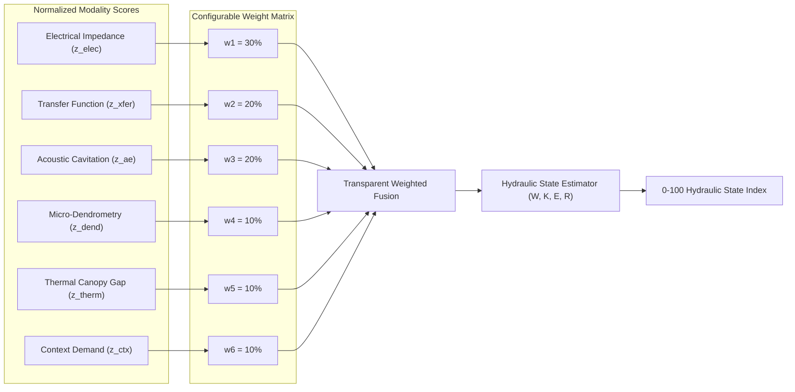

# 05. Multimodal Fusion & Hydraulic State Model

**Document:** 05_multimodal_fusion_and_hydraulic_state_model.md  
**Scope:** Weighted Evidence Fusion, State-Space Dynamics, 0–100 HSI Calculation, Spatial Localization, and Explainability  
**Status:** Core Diagnostic Engine  

---

## 1. Multimodal Evidence Fusion Architecture

PhytoSense AI does not rely on a single sensor channel. Individual sensors in field agriculture suffer from localized environmental noise:
- Electrical impedance shifts with sap ionic concentration.
- Acoustic sensors can pick up high-frequency insect activity.
- Dendrometers on mature palms register tiny deflections ($<30\,\mu\text{m}$).
- Soil moisture probes miss root-level uptake bottlenecks.

By fusing all six modalities, false alarms drop significantly while detection confidence increases:



### Configurable Modality Weights
The default physiological weights are transparent and configurable via API/admin panel:
1. **Stem Electrical Impedance ($w_{\text{elec}} = 30\%$):** Primary indicator of apoplastic water volume and membrane integrity.
2. **Multi-Height Transfer Function ($w_{\text{xfer}} = 20\%$):** Key indicator of longitudinal vascular continuity and localization.
3. **Ultrasonic Acoustic Emission ($w_{\text{ae}} = 20\%$):** Independent physical corroboration of active xylem cavitation.
4. **Micro-Dendrometry ($w_{\text{dend}} = 10\%$):** Independent physical check on diurnal tissue shrinkage.
5. **Canopy-Air Thermal Gap ($w_{\text{therm}} = 10\%$):** Physiological check on stomatal closure.
6. **VPD & Soil Context ($w_{\text{ctx}} = 10\%$):** Environmental driving force and water supply boundary.

> [!NOTE]
> Weights are explicitly marked as configurable software weights. They do not claim universal botanical permanence.

---

## 2. The 0–100 Hydraulic State Index (HSI)

### Mathematical Mapping
Each raw feature $z$-score is first mapped to a single-modality stress sub-index $S_m \in [0, 100]$ using a continuous, smooth logistic transformation:

$$S_m(z) = \frac{100}{1 + \exp\left(-1.4 \times (z - 2.0)\right)}$$

- At $z = 0.0$ (baseline): $S_m \approx 6$
- At $z = 1.0$: $S_m \approx 20$
- At $z = 2.0$ (statistically significant anomaly): $S_m = 50$
- At $z = 3.0$: $S_m \approx 80$
- At $z \ge 4.0$: $S_m \approx 98$

The composite **Hydraulic State Index (HSI)** is calculated as:

$$\text{HSI} = \sum_{m=1}^{6} w_m \cdot S_m(z_m)$$

$$\text{Confidence} = \text{QualityScore} \times \left(1.0 - 0.15 \times \text{StdDev}(S_1, \dots, S_6) / 50.0\right)$$

### Operational Risk Levels
- **0–20 (HEALTHY):** Optimal tissue hydration. Nighttime recovery $>95\%$. No acoustic cavitation.
- **21–40 (MILD STRESS):** Minor midday water tension. Transpiration normal; complete overnight refill.
- **41–60 (MODERATE STRESS):** Apoplastic water volume dropping; acoustic clicks detected; canopy temperature rising.
- **61–80 (HIGH STRESS):** Substantial cavitation; reduced stem conductance; incomplete overnight recovery. **Urgent action required.**
- **81–100 (CRITICAL STRESS):** Extensive vascular embolism; imminent loss of fronds; risk of irreversible hydraulic failure.

---

## 3. Physical State-Space Hydraulic Model

Beyond the static weighted fusion, the platform maintains a dynamic discrete-time state-space model tracking four hidden biophysical variables:

$$\mathbf{x}_t = \begin{bmatrix} W_t \\ K_t \\ E_t \\ R_t \end{bmatrix} \quad \begin{aligned} W &: \text{Stem tissue hydration fraction } [0, 1] \\ K &: \text{Longitudinal hydraulic conductance } [0, 1] \\ E &: \text{Acoustic embolism load } [0, 1] \\ R &: \text{Hydraulic refilling capacity } [0, 1] \end{aligned}$$

### State Transition Dynamics
$$\mathbf{x}_{t+1} = \mathbf{F}(\mathbf{x}_t, \mathbf{u}_t, \mathbf{e}_t) + \mathbf{w}_t$$

$$\begin{aligned}
W_{t+1} &= W_t - \beta_1 \cdot \text{VPD}_t \cdot K_t + \beta_2 \cdot \text{Irrigation}_t \cdot R_t + w_{W} \\
K_{t+1} &= K_0 \cdot (1 - E_t) + w_K \\
E_{t+1} &= \min\left(1.0, E_t + \gamma_1 \cdot \text{AE}_t - \gamma_2 \cdot W_t \cdot \text{Overnight}_t\right) + w_E \\
R_{t+1} &= R_t - \delta_1 \cdot E_t + \delta_2 \cdot \text{Overnight}_t + w_R
\end{aligned}$$

Where:
- $\mathbf{u}_t$: Controlled irrigation inputs (liters/duration).
- $\mathbf{e}_t$: Meteorological driving inputs (VPD, radiation, soil moisture).
- $\mathbf{w}_t$: Process noise vector.

### Observation Equation
$$\mathbf{y}_t = \mathbf{G}(\mathbf{x}_t) + \mathbf{v}_t$$

The sensor outputs (impedance $Z$, transfer function $H$, acoustic hits $AE$, dendrometry $D$) are modeled as non-linear functions of the hidden state $\mathbf{x}_t$, solved via an Extended Kalman Filter (EKF).

---

## 4. Spatial Localization Engine (Height & Azimuth)

PhytoHydra's 4-band stem arrangement ($N1$ to $N4$) and dual-side electrode pods (Sides A and B) enable spatial localization of hydraulic dysfunction along the trunk.

### Localization Algorithm
1. **Vertical Segmentation:**
   Segment impedance $Z_{ij}$ and transfer function $H_{ij}$ are monitored across three vertical zones:
   - **Lower Segment:** $N1$ ($0.3\,\text{m}$) to $N2$ ($0.8\,\text{m}$)
   - **Mid Segment:** $N2$ ($0.8\,\text{m}$) to $N3$ ($1.3\,\text{m}$)
   - **Upper Segment:** $N3$ ($1.3\,\text{m}$) to $N4$ ($1.8\,\text{m}$)
2. **Azimuthal Asymmetry:**
   The asymmetry coefficient $\mathcal{A}_{\text{seg}}$ between Side A (e.g., North) and Side B (e.g., South) is evaluated:
   $$\mathcal{A}_{\text{seg}} = \frac{z_{\text{seg}, A} - z_{\text{seg}, B}}{\max(z_{\text{seg}, A}, z_{\text{seg}, B}, 1.0)}$$
3. **Threshold Logic:**
   - If $|\mathcal{A}_{\text{seg}}| > 1.5$ and $\max(z_A, z_B) \ge 2.5$:
     Flag: *"Possible localized hydraulic dysfunction detected in segment [Height], Side [A/B]."*
   - If $z_A \approx z_B \ge 2.5$:
     Flag: *"Generalized trunk hydraulic tension (uniform drought stress)."*

> [!WARNING]
> **DIAGNOSTIC LANGUAGE CONSTRAINT:**  
> The system must NEVER state "Disease detected" or "Stem bleeding diagnosed".  
> The output is strictly formatted as:  
> **"Possible localized hydraulic dysfunction: Height N1–N2 (0.3–0.8 m), Side A, Confidence: 82%"**.

---

## 5. Explainable AI Rationale Generator

For every prediction, the platform synthesizes an explainable, human-readable rationale that details exactly which physical signals contributed to the HSI score:

```json
{
  "plant_id": "PALM-001",
  "hydraulic_state_index": 67.4,
  "risk_level": "HIGH",
  "dominant_signals": ["transfer_function", "acoustic_emission"],
  "explanation_text": "High hydraulic stress is indicated by a 2.8-sigma surge in acoustic cavitation events and a 2.1-sigma drop in electrical transfer conduction along lower Side A (N1-N2). Micro-dendrometry confirms an incomplete overnight recovery (64%). Soil moisture (24.5%) remains within normal historical limits, suggesting localized vascular uptake impairment rather than complete root zone dryout."
}
```
