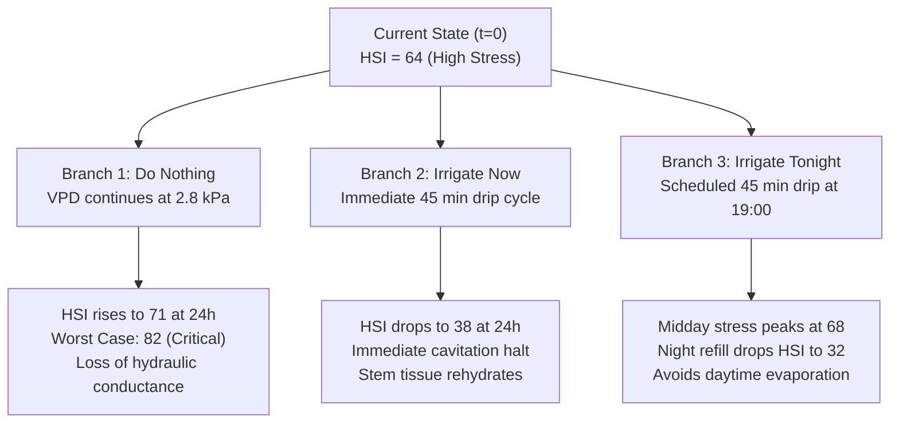

# 06. Forecasting & Recommendation Engine

**Document:** 06_forecasting_and_recommendation_engine.md  
**Scope:** 24–48h Trajectory Projections, Counterfactual Irrigation Simulator, Alert Engine, and Bilingual Agronomic Advisories  
**Status:** Core Grower Decision-Support Module  

---

## 1. 24–48 Hour Forward Trajectory Forecasting

Growers need to know not only where a palm stands today, but where its hydraulic state will trend over the next 1–2 days under anticipated weather conditions.

### Forecast Horizon & Quantiles
The engine generates predictions at four forward horizons:
- **+6 Hours:** Immediate afternoon peak stress assessment.
- **+12 Hours:** Overnight recovery refilling projection.
- **+24 Hours:** Next-day peak transpiration comparison.
- **+48 Hours:** Multi-day cumulative drought trajectory.

For every horizon $t + \Delta t$, the engine projects a three-quantile uncertainty envelope:
1. **Best Case (10th percentile):** Lower VPD, mild solar radiation, minimal cavitation.
2. **Likely (50th percentile / Median):** Expected weather trajectory based on local forecasts.
3. **Worst Case (90th percentile):** Heatwave conditions ($\text{VPD} > 3.5\,\text{kPa}$), severe cavitation, high transpirational demand.

---

## 2. Counterfactual Irrigation Simulation

A key feature for both research and farm management is counterfactual simulation: *What happens if we irrigate now vs. wait until tonight vs. do nothing?*



### Comparative Output Payload
```json
{
  "plant_id": "PALM-001",
  "current_hsi": 64.0,
  "scenarios": {
    "do_nothing": {
      "6h": {"likely": 68.0, "worst": 74.0},
      "24h": {"likely": 71.0, "worst": 82.0},
      "48h": {"likely": 79.0, "worst": 89.0},
      "outcome": "Deteriorating hydraulic function. Severe cavitation risk."
    },
    "irrigate_now": {
      "6h": {"likely": 52.0, "worst": 58.0},
      "24h": {"likely": 38.0, "worst": 44.0},
      "48h": {"likely": 22.0, "worst": 28.0},
      "outcome": "Rapid daytime recovery. High evaporation losses expected."
    },
    "irrigate_tonight": {
      "6h": {"likely": 66.0, "worst": 70.0},
      "24h": {"likely": 32.0, "worst": 36.0},
      "48h": {"likely": 19.0, "worst": 24.0},
      "outcome": "Optimal water efficiency. Full overnight vascular refilling."
    }
  },
  "recommended_regime": "irrigate_tonight"
}
```

---

## 3. Explainable Agronomic Recommendation Engine

The recommendation engine translates statistical deviations and state predictions into practical, actionable field steps:

### Rules Engine Matrix
| Trigger Condition | Primary Culprit | Actionable Recommendation | Urgency |
| :--- | :--- | :--- | :--- |
| $\text{HSI} > 60$ & Soil Moisture Normal | Localized stem or root uptake blockage | "Inspect drip lateral in Block B for blockages or filter clogging. Palms are thirsty despite moist soil." | High |
| $\text{HSI} > 60$ & Soil Moisture Low | True soil moisture depletion | "Soil water depleted. Run drip irrigation for 45 minutes after 5:00 PM." | High |
| Segment $N1–N2$, Side A Anomaly | Basal unilateral root/conduit problem | "Inspect lower trunk on north-facing side for mechanical damage or weeping lesions." | Moderate |
| Quality `BAD` (Contact $>8\,\text{k}\Omega$) | Loose titanium pin electrode | "Maintenance required: Electrode Pod N1-B is loose. Check strap tension." | Hardware |
| Post-Irrigation HSI fails to drop | Root rot or severe embolism | "Palms failed to recover 12h post-irrigation. Flag for agronomist field visit." | Critical |

---

## 4. Alert Engine & Cooldown Debouncing

### Alert Types & Severities
- `HYDRAULIC_STRESS` (Warning / High / Critical)
- `RAPID_DETERIORATION` (High — HSI jumps $>15$ points in $<3$ hours)
- `LOCALIZED_ANOMALY` (Warning — Conduction asymmetry detected)
- `SENSOR_FAILURE` (Warning — Pin detached or disconnected)
- `LOW_DATA_QUALITY` (Info / Warning — Rain contamination on bark)
- `RECOVERY_DETECTED` (Info — Post-irrigation recovery confirmed)
- `IRRIGATION_RESPONSE` (Info — Measured % recovery after watering)
- `COMMUNICATION_FAILURE` (Warning — No packet received for $>60$ minutes)

### Alert Cooldown Debouncing
To prevent spamming growers with continuous alerts every 10 minutes:
- **Default Cooldown:** 6 hours for identical severity alerts on the same plant.
- **Escalation Override:** If severity increases (e.g., `WARNING` $\to$ `CRITICAL`), cooldown is bypassed immediately.
- **Auto-Resolution:** When HSI drops below 25 for two consecutive sweeps, an active alert is marked `RESOLVED` with an accompanying resolution notification.

---

## 5. Bilingual Messaging Logic (English & Kannada)

Given that arecanut growers in Shivamogga and Dakshina Kannada manage plantations on mobile phones, push and SMS advisories are generated natively in both languages:

### Message Templates

#### Template 1: Moderate Stress with Blockage Warning
- **English:**
  > *"PhytoSense Alert: Palms in Block B are showing moderate hydraulic stress (HSI 64, High Confidence). Conduction is slow near trunk base, while soil moisture is normal. Check drip line B for clogged drippers; run 45 min after 5:00 PM."*
- **Kannada (ಕನ್ನಡ):**
  > *"ಫೈಟೋಸೆನ್ಸ್ ಎಚ್ಚರಿಕೆ: ಬ್ಲಾಕ್ ಬಿ ಸಾಲಿನ ಅಡಿಕೆ ಮರಗಳಲ್ಲಿ ನೀರಿನ ಕೊರತೆಯ ಲಕ್ಷಣ ಕಂಡುಬಂದಿದೆ (ಒತ್ತಡ ಸೂಚಿ ೬೪). ಬುಡದ ಭಾಗದಲ್ಲಿ ನೀರಿನ ಚಲನೆ ಕಡಿಮೆಯಾಗಿದೆ, ಆದರೆ ಮಣ್ಣಿನಲ್ಲಿ ತೇವಾಂಶವಿದೆ. ಡ್ರಿಪ್ ಪೈಪ್‌ನಲ್ಲಿ ಕಸ ಅಥವಾ ಕಟ್ಟಿಕೊಂಡಿದೆಯೇ ಪರಿಶೀಲಿಸಿ. ಸಂಜೆ ೫ ಗಂಟೆಯ ನಂತರ ೪೫ ನಿಮಿಷ ನೀರು ಹಾಯಿಸಿ."*

#### Template 2: Post-Irrigation Recovery Confirmed
- **English:**
  > *"PhytoSense Notice: Block B palms have recovered 88% of baseline hydration 6 hours after irrigation. Hydraulic State Index has returned to 18 (Healthy)."*
- **Kannada (ಕನ್ನಡ):**
  > *"ಫೈಟೋಸೆನ್ಸ್ ಮಾಹಿತಿ: ನೀರು ಹಾಯಿಸಿದ ೬ ಗಂಟೆಗಳ ನಂತರ ಬ್ಲಾಕ್ ಬಿ ಮರಗಳು ಶೇಕಡಾ ೮೮ ರಷ್ಟು ಚೇತರಿಸಿಕೊಂಡಿವೆ. ನೀರಿನ ಸಮತೋಲನ ಸ್ಥಿತಿಯು ಸಾಮಾನ್ಯ ಮಟ್ಟಕ್ಕೆ ಮರಳಿದೆ (ಆರೋಗ್ಯಕರ)."*
