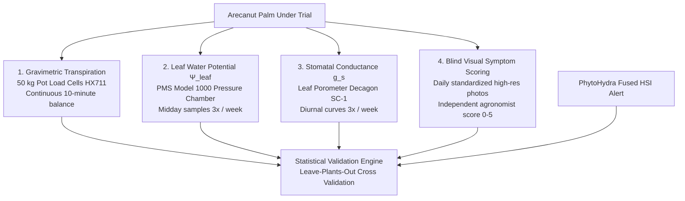

# 10. Research Validation & Ground Truth Protocol

**Document:** 10_research_validation_and_ground_truth_protocol.md  
**Scope:** Controlled Seedling Experiment Design, Ground Truth Instrumentation, Validation Gates, and Statistical Benchmarks  
**Grant Reference:** GENESIS EIR Grant PoC Validation Plan  

> [!IMPORTANT]
> **SCIENTIFIC INTEGRITY PRINCIPLE:**  
> Lead times (e.g., "detects stress 12–72 hours earlier") and water savings (e.g., "20–30% reduction") are currently **hypotheses to be tested**, not proven facts.  
> This protocol specifies the exact empirical trial required to validate or falsify these claims against gold-standard plant physiology instruments.

---

## 1. Experimental Trial Overview (Phase 1)

The objective of Phase 1 is to answer a single quantitative question:
**How many hours earlier than soil moisture, and earlier than visible wilting symptoms, does PhytoHydra reliably detect water stress in arecanut, and what is its false alarm rate?**

```text
┌────────────────────────────────────────────────────────────────────────┐
│               PHASE 1 CONTROLLED SEEDLING TRIAL DESIGN                 │
├────────────────────────────────────────────────────────────────────────┤
│ • 24 Two-year-old arecanut seedlings (variety: Mangala)                │
│ • Grown in 50 L pots under an open-sided rain shelter                  │
│ • Randomised complete block design (RCBD) across 5 treatment groups    │
│ • 18 plants instrumented with PhytoHydra seedling rigs                 │
│ • 6 plants un-instrumented to verify electrodes do not impede growth   │
│ • Repeated across 3 consecutive drying-and-rewatering cycles           │
└────────────────────────────────────────────────────────────────────────┘
```

### Treatment Groups
1. **Group 1: Control ($n=6$, 4 instrumented, 2 un-instrumented):**
   - Kept fully hydrated (100% replacement of daily pot water loss).
   - Establishes healthy baseline and defines the empirical **False Alarm Rate**.
2. **Group 2: Mild Deficit ($n=4$, all instrumented):**
   - Receives 60% of daily pot water loss.
   - Evaluates detection sensitivity at low stress thresholds.
3. **Group 3: Moderate Deficit ($n=4$, all instrumented):**
   - Receives 30% of daily pot water loss.
   - Evaluates standard agricultural stress onset and lead time.
4. **Group 4: Severe Drought & Re-Watering ($n=4$, all instrumented):**
   - Complete water withholding until visible frond drooping, followed by 100% saturation.
   - Measures early detection lead time vs. wilting and tracks post-irrigation recovery kinetics.
5. **Group 5: Split-Root Drought ($n=6$, 4 instrumented, 2 un-instrumented):**
   - Seedlings planted in divided containers with roots split equally across two halves.
   - Half A dried out; Half B kept irrigated.
   - Specifically validates whether Side A vs. Side B pods can accurately **localize unilateral root dysfunction**.

---

## 2. Independent Ground Truth Instrumentation

To avoid self-referential bias, PhytoHydra's predictions are evaluated against four independent physical standards:



1. **Gravimetric Transpiration:** Pot weight measured continuously every 10 minutes via calibrated $50\,\text{kg}$ load cells. Transpiration drop below $80\%$ of control constitutes the primary physical definition of stress onset.
2. **Leaf Water Potential ($\Psi_{\text{leaf}}$):** Midday xylem water tension measured 3 times per week using a Scholander pressure chamber (PMS Instrument Model 1000). A drop of $0.3\,\text{MPa}$ below control signifies physiological drought stress.
3. **Stomatal Conductance ($g_s$):** Measured with a steady-state leaf porometer to verify the exact moment frond stomata close to conserve water.
4. **Blind Visual Symptom Scoring:** High-resolution frond photographs captured daily at 14:00 and scored (0 = healthy, 1 = slight tip curl, 2 = frond angle loss, 3 = yellowing, 4 = severe wilting) by an independent agronomist blinded to sensor data.

---

## 3. Quantitative Validation Benchmarks & Success Gates

Before the system advances to Phase 2 commercial field pilots, it must pass 6 hard scientific gates:

| Validation Metric | Precise Mathematical Definition | Protocol Success Threshold |
| :--- | :--- | :--- |
| **Lead Time vs. Soil Moisture** | Hours between PhytoHydra warning alert and soil moisture probe crossing dry threshold ($<20\%$) | **Median $\ge 12$ Hours Earlier** |
| **Lead Time vs. Visible Wilting**| Hours between PhytoHydra warning alert and first non-zero visual symptom score | **Median $\ge 24$ Hours Earlier** |
| **Stress Detection Sensitivity** | Fraction of stressed plant-cycles detected within 24h of $\Psi_{\text{leaf}}$ dropping $0.3\,\text{MPa}$ | **$\ge 80\%$ Detection Rate** |
| **False Alarm Rate** | Spurious stress alerts triggered on well-watered Control plants | **$\le 1$ Alert per Plant per 14 Days** |
| **Localization Accuracy** | Correct identification of dry container half in Split-Root group (Side A vs. B) | **$\ge 75\%$ Correct Side Localization** |
| **Plant Biocompatibility Safety** | 120-day stem girth and frond biomass increase in instrumented vs. un-instrumented controls | **No statistically significant difference ($p > 0.05$)** |

---

## 4. Model Cross-Validation Strategy

To ensure the AI pipeline does not merely memorize individual plants:
- **Leave-Plants-Out Cross-Validation (LPOCV):** The fusion weights and baseline algorithms are trained on $N-4$ plants and evaluated strictly on the 4 held-out plants.
- **Cycle Independence:** Models trained on Drying Cycle 1 are tested forward on Cycles 2 and 3 to confirm performance under repeated seasonal stress.
